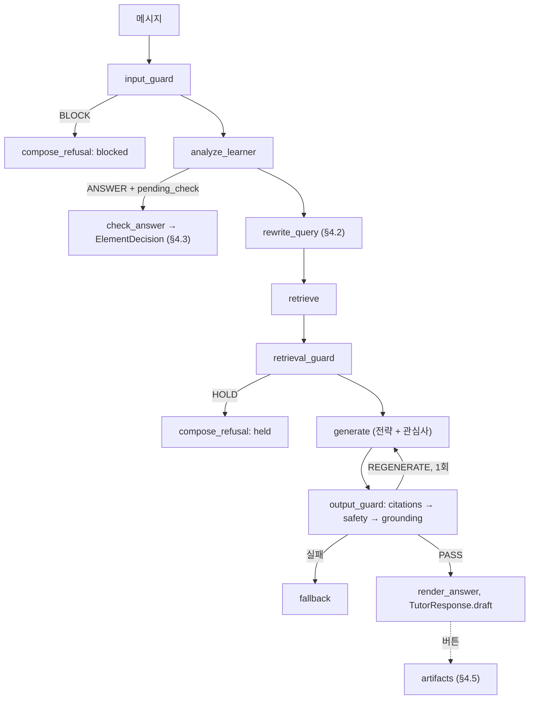

# SPEC — 안전벨트를 채운 AI 튜터 (구현 명세)

> 버전 0.2 · 2026-11-06 · 상태: 제안 (팀 합의 전).
> 읽는 순서: `AGENTS.md` → 이 문서 → `docs/MODULES.md` → `src/contracts/`
> 계약 변경은 `docs/CONTRACT_PROPOSAL.md` 가 합의·반영되기 전까지 코드에 적용하지 않는다.
> 설계 근거: `docs/design/` (디자인 씽킹, 학습수준 판별 로직·소프트웨어 설계, 학습 문서 안내, 관심사 연결 아이디어)

## 0. 한 줄 정의

수업 자료 근거 안에서 학생이 어디서 막혔는지 먼저 찾고 한 단계씩 넘겨 주는 AI 튜터 챗봇. 범위 이탈·유해·공격 요청은 막고, 정상 학습 질문은 막지 않는다.

## 1. 평가 기준과 우선순위

- 엘리스 산출물 평가: 학습 에이전트(검색된 청크 안에서만 답변, 모든 답변에 문서·단원 출처) + 가드레일 모듈(입출력 단계 적용, 근거 이탈·부적절 내용 검증).
- 절대 자르지 않는 것 (`docs/TEAM_GUIDE.md`): 4단계 비교표, 오탐률 측정, 홀드아웃 측정, 주장-근거 일치 검증.

| 등급 | 기능 | 절 | 시기 |
|---|---|---|---|
| Must | 근거 답변·출처, 입력·검색·출력 가드, 4모드 평가 | §4.1 | ~11/11 |
| Must | 후속 질문 처리 (`rewrite_query`) | §4.2 | 11/9–10 |
| Should | 막힘 루프 + 확인 답 판정 (E/X/U/NA) | §4.2, §4.3 | 11/9–11 |
| Should | txt 학습 노트 (오답 분석, '내 말로 정리' 빈칸 포함) | §4.5, §4.6 | 11/11–12 |
| Could | 관심사 비유 (선택 설정) | §4.4 | 11/11–12 |
| Could | 카드뉴스 PNG, 개념도(손그림 스타일) | §4.5 | 11/12–13 (동결 전, 여유 시) |
| Could | 자유 노트 확인 (질문 은행 개념만) | §4.6 | 11/12–13 (동결 전, 여유 시) |
| Won't (대회 전) | React·FastAPI 전환, 사용자 자료 업로드, 세션 간 학습자 저장, 교사 검토 워크플로 전체, 노트 수정본 이력, 강의 회차 재생성 | §8 | — |

- 일정이 밀리면 Could → Should 순으로 자른다. 기능 동결: 11/13 저녁.

## 2. 화면과 사용 흐름 (Streamlit 챗봇)

| 영역 | 내용 | 비고 |
|---|---|---|
| 채팅 (`st.chat_input`, `st.chat_message`) | 질문 → 답변(핵심 설명, 비유, 근거 출처, 이해 확인 질문) | 기본 경로. 평가 러너와 같은 `ask()` |
| 처리 과정 (`st.expander`, `st.status`) | 단계별 결과(trace), 검사 단계 진행 | 검사 끝나기 전 답 노출 금지 |
| 사이드바 | 모드, 수준(수동), 관심사(선택, 0–5개), 대화 초기화 | 관심사 기본값 없음 |
| 출력물 버튼 | 학습 노트(txt), 카드뉴스, 개념도 | `ask()` 밖에서 실행 (§4.5) |
| 자유 노트 (Could) | 노트 입력 칸 + 개념 선택 + '노트 확인' 버튼 | `ask()` 밖에서 실행, 질문 은행 개념만 (§4.6) |

- 기본 경로는 '바로 질문'이다. 관심사 설정·진단 퀴즈는 선택이며, 없어도 모든 기능이 동작해야 한다. 평가 러너는 질문마다 새 `LearnerState` 로 실행한다.

| 메시지 유형 | 판별 | 처리 |
|---|---|---|
| 새 질문 | 기본 | 기존 `ask()` |
| 후속 질문 ("더 쉽게", "그건 왜?", "퀴즈 내 줘") | 직전 대화에 기대는 질문 | §4.2 `rewrite_query` 후 검색 |
| 확인 질문에 대한 답 | `state.pending_check` 있음 + `Intent.ANSWER` | §4.3 `check_answer` |
| 막혔어요 | 버튼 → 고정 메시지 | `Intent.CONFUSED` 전략 + 시도 묻기 (K1) |
| 출력물 요청 | 버튼 | §4.5 |
| 자유 노트 확인 | 버튼 | §4.6 |

## 3. 처리 구조



- 신규: `rewrite_query`, `check_answer` (P3), `src/artifacts/` (담당 배정 필요).
- 모드 규칙: `rewrite_query`·`check_answer` 는 `tutor` 플래그가 켜진 모드에서만. LLM 판정은 `llm_judges` 플래그가 켜진 모드에서만 (`code_guard` 는 LLM 판정 없음).

## 4. 기능 명세

### 4.1 근거 답변과 가드레일 (Must)

기존 `docs/MODULES.md` P1·P2 항목 그대로. 디자인 씽킹 기준(K)과의 대응:

| K | 기준 | 구현 위치 |
|---|---|---|
| K4 | 문장마다 근거(문서·단원·페이지), 근거 없으면 답하지 않음 | `retrieval_guard`(HOLD), `check_citations`, `check_grounding`, `render_answer` |
| K5 | 거절에는 이유 범주 + 다시 물을 학습 질문. 판단은 의도로 | `input_guard` v1(의도 분류), `compose_refusal` 에 카테고리별 재질문 예시 2–3개 추가 |
| K6 | 검사 후에만 답 노출, 대기 중 검사 단계 표시 | `pipeline`(스트리밍 없음), 화면 `st.status`. 단계별 실시간 갱신은 선택 계약 `ask(on_stage=…)` (CONTRACT_PROPOSAL §3.1) |
| K7 | 오탐·미탐·근거 일치를 같은 테스트셋으로 측정 | `eval/` 4모드, `pair`·`holdout_a`·`holdout_b` 세트 |

### 4.2 막힘 루프와 후속 질문 (Must·Should)

| K | 동작 | 구현 |
|---|---|---|
| K1 | 과제성·막힘 질문에 바로 풀이를 주지 않고, 시도·생각을 먼저 묻는다 (대화에 시도가 없을 때) | `strategy.pick_strategy` 에 '시도 묻기' 단계 추가 (HINTS 앞) |
| K2 | 한 번에 한 단계. 막다른 거절 없음: 힌트 마지막 칸(`단계별 풀이 보여주기`) 또는 자기 설명 E 판정이면 전체 풀이 공개(정답 해금) | 기존 `HINTS`·`hint_count`. 해금 비율은 로그로 측정 |
| K3 | 답마다 확인 질문. 다음 턴 답을 §4.3으로 판정. X면 막힌 지점으로 되돌아감 | `TutorDraft.check_question` + `check_points`(제안), `check_answer` |

- `rewrite_query(query, history, state) -> str`: 직전 대화를 넣어 독립된 질문으로 바꾼다 (`docs/MODULES.md` '뼈대에 아직 없는 기능' #1). 후속 질문이 직전 답의 재설명 요청이면 `state.last_chunks`(제안)를 근거로 재사용할 수 있다.

### 4.3 요소별 이해 판별 (Should)

원칙 (`docs/design/학습수준_판별로직.md`):

- 키워드 출현·문장 유사도로 이해를 인정하지 않는다. 평가 요소(element)별로 필수 내용이 학습자 원문에 있는지 본다.
- 상태는 E(충족 증거) / X(충돌 증거) / U(확인 필요) / NA(대상 아님). 처리 실패는 학습 상태가 아니다.
- 점수·백분율로 바꾸지 않는다. E는 그 요소의 증거일 뿐 개념 숙달 판정이 아니다.
- 첫 답, 질문 후 답, 힌트 후 답은 구분해 기록한다 (`stage`).

챗봇 MVP (`docs/design/학습수준_판별로직_소프트웨어설계.md` 의 축소판):

| 항목 | 설계 문서 | MVP |
|---|---|---|
| 기준표 | 교사 승인 RubricVersion | ① 질문 은행: 팀이 교육자료 핵심 개념별로 쓰고 검토한 확인 문제 + 필수 요소 + 오개념 (`approved=true`) ② 생성 확인 문제: `generate` 가 만든 `check_question` + `check_points`(인용 범위 안) (`approved=false` → 연습 피드백으로만 표시) |
| 증거 추출 | EvidenceCandidate (슬롯·문맥) | judge LLM(`chat_json`, role=`judge`)이 요소별 `{status, learner_quote}` 반환 |
| 검증기 | 원문 인용·문맥·수식 검증 | `learner_quote` 가 학습자 답(정규화 후)에 실제로 들어 있는지 코드로 확인. 없는 인용은 버린다 |
| 판정 | 우선순위 규칙 | 처리 실패 → 판정 미발행(`None`) / 검증된 충돌 → X / 모든 필수 요소 지지 → E / 나머지 → U + `reason_code` |
| 후속 질문 | 승인 질문 은행 | `reason_code` 별 템플릿 (MISSING_SUBJECT, MISSING_RELATION, CONDITION_UNOBSERVED, EXPLICIT_ERROR, INTERNAL_CONFLICT, NO_EVIDENCE) |
| 기록 | 변경 불가 이력, ReviewEvent | `LearnerState.element_decisions`(세션 한정, 제안) + `TutorResponse.check_result`(제안) |
| 위치 오프셋 | (설계 문서 4.2) | Python 문자열 인덱스 기준 |

- 소프트웨어 설계 문서 8절은 검토 전 생성 질문을 학생에게 내지 않는다. 챗봇 MVP는 K3(답마다 확인 질문) 때문에 생성 질문도 내고 `approved=false` 로 구분한다. 이 차이는 팀 합의가 필요하다.
- 질문 은행 위치·형식 제안: `data/question_bank.yaml`. 항목마다 `concept`, `element_id`, `question`, `check_points`, `misconceptions`, `chunk_ids`. 팀 검토를 마친 항목만 넣는다 (`approved=true`).

| 판정 | 다음 행동 |
|---|---|
| E | 다음 단계 또는 정답 해금 (K2) |
| X | 충돌한 학습자 문장을 인용하고 근거 청크로 막힌 지점을 짚은 뒤 새 확인 문제를 낸다 (`Intent.CONFUSED` 전략, 오답 분석 후 재시험 §4.6) |
| U | 사유별 명료화 질문 1개 |
| NA | 없음 |
| 미발행(처리 실패) | "분석을 완료하지 못했어요" 표시, `pending_check` 유지, 재시도 |

- `Level`(beginner/intermediate)은 설명 방식을 고르는 값이다. 판정 한 번으로 바꾸지 않는다 (`tutor.level_confidence_threshold` 규칙 유지).
- `code_guard` 모드: LLM 판정을 하지 않는다. 판정을 기록하지 않고 근거 청크를 보여 주며 스스로 비교하게 한다.
- 설계 문서의 예시는 확률 단원이다. 실제 기준표는 엘리스 교육자료 단원으로 새로 쓴다.

예시 (엘리스 슬라이드 Helpy Edu 장면: 파이썬 리스트·튜플):

| 항목 | 내용 |
|---|---|
| 확인 질문 | "에러가 나는 줄을 고르고, 이유를 '튜플은 __하기 때문에'처럼 써 보세요." |
| element_id | `tuple-immutability-reason` |
| 필수 요소 | 튜플은 만든 뒤 요소를 바꾸거나 추가할 수 없다 |
| 오개념 예 | 튜플도 `append` 로 요소를 추가할 수 있다 |
| "튜플은 값을 변경할 수 없어서 2번이 에러" | E |
| "튜플도 append는 되는데 느려서" | X (EXPLICIT_ERROR) |
| "튜플이라서요" | U (MISSING_RELATION) → "튜플의 어떤 성질 때문인지 한 문장으로 써 볼래요?" |

### 4.4 관심사 연결 (Could)

`docs/design/아이디어_사용자 관심사와 연결.md` 를 근거 원칙에 맞춰 채택:

| 팀원 아이디어 | 채택 방식 | 이유 |
|---|---|---|
| 자료 입력 → 카테고리 | 엘리스 제공 교육자료의 단원(`Chunk.section`)을 카테고리로 사용 | 업로드는 대회 범위 밖 (간접 인젝션·개인정보·일정) |
| 관심사 5~7개 선택 + 연관 키워드 제안 | 사이드바에서 0–5개 선택, 기본 없음. 연관 제안은 여유 시 | 바로 질문 경로를 막지 않기 |
| 배경지식 진단 퀴즈 (주관식) | §4.3 판정 엔진 재사용, 선택 기능 | 판정 규칙 하나로 통일 |
| 강의 순서 재구성 | '학습 경로' 출력물: `Chunk.prerequisites`·`difficulty` + 판정 결과로 단원 순서 제안 (개념도·txt) | 강의 내용 재생성은 근거 검증 부담이 큼 |
| 관심사 비유 | `TutorDraft.analogy` 에만, '비유' 표시, 교재에 없는 사실·수치 금지, grounding 완화 검사 | 청크 안 답변 요구 (R1, K4) |
| 보충 자료 검색 (에이전트 3) | 교육자료 안에서만. 외부 자료는 사실 근거로 쓰지 않음 | 청크 안 답변 요구 |
| 자료 검토 (에이전트 4) | `output_guard` 가 담당 | 기존 모듈 재사용 |
| 학습자 데이터 이전 | 세션 상태만. 사용자가 txt로 내려받아 보관 | 개인정보 |

- 에이전트 대응: 1 → `tutor/state`·`analyze` / 2 → `rag/ingest` (+ `prerequisites` 태깅) / 3 → `retrieve`(교육자료 한정) + `generate` 의 analogy / 4 → `guardrails/output` / 5 → `tutor/generate`·`check` + `artifacts`. 별도 멀티 에이전트 프레임워크는 만들지 않는다.
- `build_prompt` 추가 지시: "[학습자 관심사] {interests}. 비유가 도움이 될 때만 관심사를 소재로 analogy에 쓰고, analogy에는 교재에 없는 사실·수치를 넣지 마라."

### 4.5 학습 출력물: txt · 카드뉴스 · 개념도

| 종류 | 형식 | 만드는 법 | 화면·내려받기 |
|---|---|---|---|
| 학습 노트 (Should) | `.txt` (UTF-8) | 검증 통과한 `TutorResponse.draft` 로 결정적 템플릿 조립: 제목, 질문, 핵심 설명, 근거(문서·단원·p.), 비유(표시), 확인 질문·내 답·판정, 오답 분석(X: 내 답 인용·근거·다시 풀 문제), 다음에 할 것, '내 말로 정리' 빈칸(자유 노트, §4.6) | `st.download_button` |
| 카드뉴스 (Could) | PNG 여러 장 (예: 1080×1080) | `ArtifactSpec` → Pillow 템플릿. 카드 구성: 표지 1, 사실 카드(주장 1개 = 1장), 비유 1, 확인 질문 1, 출처 1. 한글 폰트를 저장소에 포함 (예: Noto Sans KR, OFL) | `st.image` + zip 내려받기 |
| 개념도 (Could) | Mermaid 텍스트 (`look: handDrawn`) | v0: 단원·선수 개념(`Chunk.prerequisites`)으로 그래프. v1: 검증된 claims에서 (개념, 관계, 개념) 추출, 관계마다 citation | `st.components.v1.html` 로 Mermaid 렌더(손그림 스타일), `.mmd` 내려받기. `.excalidraw` 내보내기는 여유 시 |

규칙:

- 출력 가드를 통과한 내용만 쓴다. 인용이 없거나 이번 답의 근거가 아닌 chunk_id를 인용한 항목은 버린다 (`check_citations` 재사용).
- 렌더러는 LLM을 부르지 않는다 (같은 입력 → 같은 출력, 테스트 가능).
- 출력물 생성은 `ask()` 밖에서 버튼으로만 실행한다. 평가 지연·호출 수에 영향이 없어야 한다.
- 비유 항목에는 "비유" 라벨을 붙인다.
- 파일 위치 제안: `src/artifacts/{build.py, render_txt.py, render_cards.py, render_map.py}`, `assets/fonts/`.
- 의존성: 카드뉴스를 만들면 `requirements.txt` 에 `pillow` 추가. txt·Mermaid 텍스트는 표준 라이브러리로 충분하다.

확인한 기술 사실 (2026-11-06):

| 항목 | 내용 | 출처 |
|---|---|---|
| Excalidraw 파일 | JSON. 최상위 `type`("excalidraw"), `version`, `source`, `elements`, `appState`, `files` | [JSON Schema](https://docs.excalidraw.com/docs/codebase/json-schema) |
| 요소 프로그램 생성 | `convertToExcalidrawElements` (JS, 베타 API). rectangle·ellipse·diamond·text·arrow 등, 라벨·화살표 연결 지원 | [Element Skeleton](https://docs.excalidraw.com/docs/@excalidraw/excalidraw/api/excalidraw-element-skeleton) |
| Mermaid → Excalidraw | `@excalidraw/mermaid-to-excalidraw` 의 `parseMermaidToExcalidraw` (JS, MIT) | [GitHub](https://github.com/excalidraw/mermaid-to-excalidraw) |
| Mermaid 손그림 | `look: handDrawn` (RoughJS 기반, 2024-08 공지). flowchart·state diagram 지원 | [Mermaid 블로그](https://docs.mermaidchart.com/blog/posts/mermaid-innovation-introducing-new-looks-for-mermaid-diagrams) |
| Rough.js | 손그림 스타일 그래픽 라이브러리, Canvas·SVG, MIT | [GitHub](https://github.com/rough-stuff/rough) |

- Excalidraw·Mermaid 변환은 JS 라이브러리다. 현재 스택(Python·Streamlit)에서는 Mermaid 렌더(브라우저)까지만 하고, `.excalidraw` 파일은 여유 시 추가한다.
- Mermaid를 CDN에서 불러오면 데모 환경에 인터넷이 필요하다. 오프라인이면 스크립트를 저장소에 포함한다. 버전은 고정한다.

### 4.6 학습 활동 대응 (`docs/design/학습 문서 안내.md`)

팀원 안내 문서의 학습 활동 3가지를 챗봇 기능에 대응시킨다. `학습방법.md` 본문(실행 방법·효과·참고 자료)은 미공유라, 받으면 이 표와 질문 문구를 다시 맞춘다.

| 학습 활동 | 챗봇 대응 | 등급 · 절 |
|---|---|---|
| 설명하기 | 확인 질문에 자기 말로 답 → 요소별 판정. 자기 설명이 E면 정답 해금 | Should · §4.2 K2, §4.3 |
| 빈 텍스트 파일에 자유 노트 작성하기 | ① txt 학습 노트 끝의 '내 말로 정리' 빈칸에 쓴다 ② 자유 노트 확인: 노트를 붙여 넣고 개념을 고르면 그 개념의 요소마다 판정 | ① Should · §4.5 ② Could · 아래 |
| 오답 분석 후 재시험 | X 판정 → 충돌한 내 답 인용 + 근거로 짚기 → 새 확인 문제(재시험). txt 학습 노트에 '오답 분석' 절 | Should · §4.3, §4.5 |

자유 노트 확인 (Could):

- 대상: 질문 은행(`approved=true`)에 요소가 정의된 개념만. 기준표가 없는 노트는 판정하지 않는다 (판별 설계 원칙: 승인 기준 없이 판정하지 않음).
- 처리: 노트 → `input_guard` 의 마스킹·인젝션 검사 → 개념의 요소마다 `check_answer(note, 요소 기준, 근거 청크)` → `ElementDecision(stage="initial")` 목록 → U·X 요소마다 후속 질문 1개 (§4.3 다음 행동 표).
- 근거 청크: 질문 은행 항목의 `chunk_ids` 로 가져온다. id 조회 함수가 `rag` 에 필요하면 P1·P3가 합의해 계약에 추가한다 (`docs/CONTRACT_PROPOSAL.md` 형식).
- 노트 안의 지시문은 판정 기준을 바꾸지 않는다. judge 프롬프트에서 노트는 데이터로만 다룬다.
- 판정은 제안 계약 `AnswerChecker` 를 그대로 쓴다: 요소 기준을 `pending_check` dict(`element_id`, `check_points`, `approved`)에 담아 요소마다 호출한다. `ask()` 밖에서 실행하고, `llm_judges` 가 꺼진 모드에서는 하지 않는다.
- 하지 않는 것 (§8): 노트 수정본 이력(소프트웨어 설계의 NoteRevision), 교사 검토 화면, 여러 노트 비교.

## 5. 계약 변경 제안 (요약)

세부와 코드: `docs/CONTRACT_PROPOSAL.md`. 모두 추가(기본값 있음)라 기존 코드·테스트를 깨지 않는다.

| 위치 | 추가 |
|---|---|
| `categories.py` | `ElementStatus`(E/X/U/NA), `ArtifactKind`(note_txt/card_news/concept_map) |
| `schemas.py` | `ElementDecision`, `ArtifactItem`, `ArtifactSpec` / `TutorDraft.check_points`, `TutorDraft.check_element_id` / `LearnerState.interests`, `element_decisions`, `last_chunks` / `TutorResponse.draft`, `check_result` |
| `interfaces.py` | `QueryRewriter`, `AnswerChecker`, `ArtifactBuilder`, `ArtifactRenderer` / 선택: `Pipeline` 에 `on_stage` |

## 6. 설정 키 제안 (`settings.yaml`)

```yaml
tutor:
  max_interests: 5
artifacts:
  card_size_px: 1080
  max_cards: 6
  font_path: assets/fonts/NotoSansKR-Regular.ttf
  mermaid_look: handDrawn
```

## 7. 테스트·평가 추가 (완료 기준)

| 파일 | 검사 |
|---|---|
| `tests/test_rewrite.py` | 후속 질문이 직전 맥락을 담은 독립 질문으로 바뀜 (fake LLM) |
| `tests/test_check.py` | 답에 없는 인용은 무시 / 검증된 충돌 X가 E보다 우선 / 모든 요소 지지 → E / LLM·파싱 실패 → `None` / `code_guard` 모드 LLM 호출 0 / 자유 노트: 질문 은행에 없는 개념은 판정 안 함, 요소마다 `stage="initial"`, 노트 속 지시문이 판정 기준을 바꾸지 않음 |
| `tests/test_artifacts.py` | 인용 없는 항목·근거 밖 인용 항목 제외 / txt 결정적·출처 포함·오답 분석 절과 '내 말로 정리' 빈칸 포함 / 카드 PNG 시그니처와 장수 / Mermaid에 `look: handDrawn` 과 스펙의 노드만 / 비유 라벨 |
| `eval/` | 확인 답 판정: 팀이 따로 라벨링한 답 30개와 비교. E 과잉 인정, X 과잉 판정, U 과다를 따로 센다 (판별로직 §11) |

- 기존 테스트를 깨지 않는다 (Streamlit 설치 시 50 passed·1 xfailed, 미설치 시 49 passed·1 skipped·1 xfailed).

## 8. 대회 전에 하지 않는 것

| 항목 | 이유 |
|---|---|
| React·FastAPI 전환 | Streamlit 데모와 테스트가 이미 있고, 기능 동결이 11/13 |
| 사용자 자료 업로드 | 간접 인젝션·개인정보 검사 범위 증가. 엘리스 제공 자료로 평가 |
| 세션 간 학습자 저장 | 개인정보. txt 내려받기로 대체 |
| 교사 검토 워크플로 전체 (ReviewEvent, 버전 승인 UI) | 팀이 질문 은행을 직접 검토하는 것으로 대체 |
| 노트 수정본 이력 (NoteRevision), 여러 노트 비교 | 저장·권한 설계가 필요. 질문 은행 개념의 자유 노트 확인(§4.6)까지만 |
| 강의 회차 재생성 | 근거 검증 부담. 학습 노트·학습 경로로 대체 |

## 9. 용어·ID

| ID | 뜻 | 어디 |
|---|---|---|
| P1–P4 | 팀 역할 (검색·근거 / 입력·안전 / 튜터·통합 / 평가·발표) | `AGENTS.md` |
| L1–L5 | 학습자 페르소나 | 디자인 씽킹 문서 |
| K1–K7 | 만들 것의 기준 | 디자인 씽킹 문서 §3.2 |
| I01–I37 | 아이디어 | 디자인 씽킹 문서 §3 |
| E / X / U / NA | 요소별 판정 상태 (`ElementStatus`). 디자인 씽킹 문서의 외부 근거 ID(E01–E16)와 다름 | §4.3 |
| element | 한 번에 확인할 수 있는 작은 수행 단위 | 판별로직 §3 |

## 10. 미확인

- 엘리스 ML API 실제 형식 (`llm_client._http_chat` 가정 기반), 모델 이름.
- 경진대회 평가 기준 이미지 (「발표 순서 및 이모저모.md」), 데모 링크 제출 방식.
- `학습방법.md` 본문: '학습 문서 안내'만 받음 (학습 활동 3가지 확인). 실행 방법·효과·참고 자료는 미공유.
- 챗봇을 우리 Streamlit 앱으로 띄우는지, 엘리스 플랫폼에 붙이는지.
- 배포 환경의 한글 폰트·인터넷(Mermaid CDN)·포트 공개.
