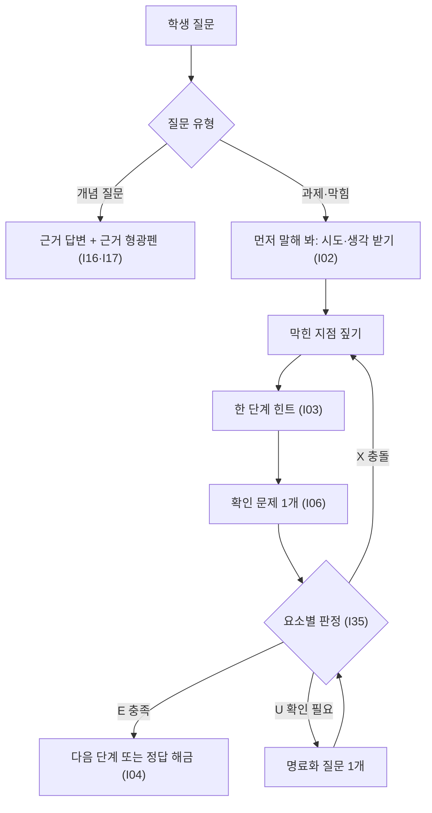

# 안전벨트를 채운 AI 튜터 — 디자인 씽킹

## 0. 요약

| 항목 | 내용 |
|---|---|
| 과제 | 교육자료 근거 답변 + 범위 이탈·유해 요청 차단을 함께 하는 튜터 에이전트와 가드레일 (엘리스) |
| 평가 산출물 (E13 p.6) | 학습 에이전트: 검색된 청크 안에서만 답변, 모든 답변에 문서·단원 출처 / 가드레일 모듈: 입출력 단계 적용, 근거 이탈·부적절 내용 검증 |
| 사용자 | 교육자료로 공부하는 학습자 (대학생·부트캠프 수강생) |
| 메인 POV-1 | 막힌 학생에게 빠진 것은 정답이 아니라 '어디서 막혔는지'. 정답을 받으면 이해 착각, 거절을 받으면 다른 AI로 이탈 |
| 보조 POV-2·3 (필수 조건) | AI 설명이 수업 자료와 같은지 바로 대조할 수 있어야 믿는다 / 이유·대안 없는 거절은 학생을 가드레일 없는 AI로 보낸다 |
| 해결책 | 수업 자료 근거 안에서 막힌 지점을 먼저 찾고 한 단계씩 넘기는 AI 튜터 (기준 K1–K7) |
| MVP | 근거 형광펜 · 근거 없으면 답 안 함 · 친절한 차단 카드 · 의도 판단 · 막힘 루프 + 요소별 이해 판별 + 정답 해금 · 가드레일 실험실(4모드 비교) · txt 학습 노트 |
| 구현 | 팀 스켈레톤 `ai_tutor_skeleton`: Streamlit 챗봇 + Python 파이프라인(입력·검색·출력 가드 + 튜터), 4모드 비교(baseline / prompt_only / code_guard / full), 역할 P1–P4. 학습 출력물 txt + 카드뉴스·개념도(손그림 스타일). 임베딩은 로컬 오픈 모델(BGE-M3 제안), 생성·판정은 ML API. 엘리스 클라우드 배포 → 데모 링크. 상세: 저장소 `docs/SPEC.md` |
| 신규 반영 (2026-11-06) | 팀원 문서: 요소별 이해 판별(→ I35), 관심사 연결(→ I34), 학습 활동 3가지(설명하기·자유 노트·오답 분석 후 재시험 → I35·I36). 사용자 요구: txt·인포그래픽 출력(→ I36, I37) |
| 검증 상태 | 근거 발언 대부분 [가상] → POV·K는 가설. Prototype·Test에서 확인 |

## 1. Empathize (공감)

### 1.1 과제와 사람

- 쉬운 말: 수업 자료를 근거로 학생 수준에 맞춰 같이 풀어 주고, 공부와 무관하거나 위험한 요청은 공부로 되돌리는 AI 선생님.
- 요구자: 엘리스그룹 (Helpy Edu·Helpy Code·ML API 운영). 목표(기관이 믿고 도입하는 튜터)는 학습자가 계속 써야 달성된다.
- 사용자 = 공감 대상: 학습자. 간접 이해관계자: 교강사·교육기관 (부정행위 방지, 안전, 커리큘럼 일치, 학습 기록 확인).
- 방법: 인터뷰 없이 남은 흔적 읽기(E) + 가설 발언 구성. 예시 도메인은 프로그래밍·AI 강의자료 (실제 교육자료 수령 후 조정).

### 1.2 페르소나

| L | 유형 | 하려던 일 | 멈춘 곳 | 말 ↔ 속마음 어긋남 |
|---|---|---|---|---|
| L1 | 입문자 (비전공, 처음 보는 개념) | 개념을 이해하고 실습 과제 제출 | 설명 속 모르는 용어, 이해 여부를 판단 못 함 | "쉽게"를 요청하지만 필요한 건 막힌 곳 짚기와 이해 확인. 코드 실행 성공이 이해 착각을 만듦 |
| L2 | 심화 탐구자 (전공 3–4학년) | 원리·설계 이유까지 이해 (예: chunk overlap, top-k) | 검증에 시간이 더 듦, 수업 자료와 정의·수치가 다름 | 출처를 요청하지만 필요한 건 검증 시간 단축: 답·근거 일치, 수업 기준 일치, 모르면 모름 |
| L3 | 마감·시험형 | 과제 제때 제출, 시험·실습 통과 | 제출한 코드를 설명 못 함, 혼자 풀 때 막힘 | "정답"을 요청하지만 목표는 마감 내 완료 + 다음에 혼자 하기 + 떳떳한 도움. 거절만 하면 다른 AI로 감 |
| L4 | 재질문형 (한 지점이 헷갈림) | 헷갈리는 한 지점 정리 (예: 튜플 안 리스트) | 자기 오개념 위치를 모름, 긴 답에서 핵심을 놓침 | 짧게 묻는 건 한 지점만 막혀서. 필요한 건 오개념 진단과 짧은 확인 |
| L5 | 차단당한 학습자 (LLM·보안 과목) | 수업에서 배운 공격 원리 이해 (예: 프롬프트 인젝션) | 거절 이유를 모름, 다시 물을 방법을 모름 | "왜 막아?"는 표면. 속마음은 의심받은 느낌과 '계속 써도 되나'. 과잉 차단 → 가드레일 없는 AI로 이동 |

### 1.3 발언 (Q)

| Q   | L   | 유형              | 발언                                                         |
| --- | --- | --------------- | ---------------------------------------------------------- |
| Q01 | L1  | 가상              | 모르는 걸 물어봤는데 설명에 모르는 단어가 더 나와요                              |
| Q02 | L1  | 가상              | 뭘 모르는지를 몰라서 뭘 물어야 할지 모르겠어요                                 |
| Q03 | L1  | 가상              | 코드는 돌아가길래 넘어갔는데 퀴즈에서 똑같은 걸 틀렸어요                            |
| Q04 | L1  | 가상              | AI가 틀렸는지 저는 판단을 못 하니까 그냥 믿어요                               |
| Q05 | L1  | 가상              | 기초적인 걸 계속 물어보면 눈치 보여서 사람한테는 못 물어봐요                         |
| Q06 | L2  | 가상              | '왜'를 물으면 교과서 첫 줄 같은 일반론만 반복해요                              |
| Q07 | L2  | 가상              | 출처를 달라고 해서 찾아봤더니 없는 논문이었어요                                 |
| Q08 | L2  | 가상              | 제가 반박하면 바로 '맞습니다'로 바꿔요. 그럼 처음 답은 뭐였죠?                      |
| Q09 | L2  | 가상              | 강의자료랑 AI 설명이 달라서 시험엔 뭘 써야 할지 모르겠어요                         |
| Q10 | L2  | 가상              | 확인하는 데 시간이 더 걸려요. 이럴 거면 제가 찾아보는 게 낫겠다 싶어요                  |
| Q11 | L3  | 실제 (E15)        | 인공지능(AI) 안 쓰면 바보죠. … 안 쓰면 오히려 손해 아닌가요?                     |
| Q12 | L3  | 실제 (E15)        | 누군가는 안 걸리고 커닝할 수 있는 구조이니 혼자 AI를 안 쓰면 불리하다고 생각하게 된다         |
| Q13 | L3  | 가상              | 시간 없어서 답부터 받았어요. 이해는 나중에 하려 했는데 나중은 안 오더라고요                |
| Q14 | L3  | 가상              | 제가 낸 코드인데 설명해 보라고 하면 못 하겠어요                                |
| Q15 | L3  | 가상              | 힌트만 주는 AI는 답답해서 그냥 다른 AI 켜요                                |
| Q16 | L3  | 가상              | 이 정도 도움은 받아도 되는 건지 모르겠어요                                   |
| Q17 | L4  | 가상              | 그래서 결국 바뀐다는 거예요, 안 바뀐다는 거예요?                               |
| Q18 | L4  | 가상              | 제가 뭘 잘못 알고 있는지만 짚어 주면 되는데, 처음부터 다시 설명해요                    |
| Q19 | L4  | 가상              | 길게 설명해 주면 어디가 제 질문의 답인지 놓쳐요                                |
| Q20 | L4  | 실제 (E07, 홍보 자료) | It was like a tutor who doesn't get tired of my questions. |
| Q21 | L5  | 가상              | 수업 시간에 배운 걸 물어봤는데 '도와드릴 수 없습니다'만 나와요                       |
| Q22 | L5  | 가상              | 왜 안 되는지라도 알려 주면 다르게 물어볼 텐데요                                |
| Q23 | L5  | 가상              | 결국 다른 AI한테 물어봤어요                                           |
| Q24 | L5  | 가상              | 어제는 답해 줬는데 오늘은 막혀요. 기준이 뭔지 모르겠어요                           |

### 1.4 숨은 니즈 (N)

| N   | 숨은 니즈                            | Q                  | L          | R          |
| --- | -------------------------------- | ------------------ | ---------- | ---------- |
| N01 | 내가 아는 데서 출발하는 설명 (모르는 용어는 먼저 풀기) | Q01, Q02           | L1         | R4         |
| N02 | 모르는 것을 대신 진단                     | Q02                | L1         | R4         |
| N03 | 이해했는지 확인                         | Q03, Q17           | L1, L4     | R4         |
| N04 | 믿을 수 있는 답·도구                     | Q04, Q07, Q08, Q23 | L1, L2, L5 | R1, R2, R3 |
| N05 | 반복 질문에 부담 없음                     | Q05, Q20           | L1, L4     | —          |
| N06 | 주장별 근거 위치를 바로 확인                 | Q07, Q10           | L2         | R2         |
| N07 | 수업 기준(자료의 정의·표기)과 같은 답           | Q09                | L2         | R1         |
| N08 | 근거 없으면 "자료에 없음"                  | Q07, Q08           | L2         | R3         |
| N09 | 일반론에서 멈추지 않는 깊이                  | Q06                | L2         | R4         |
| N10 | 마감 안에 끝내되 내 것으로                  | Q11, Q13           | L3         | R5         |
| N11 | 다음엔 혼자 해내기                       | Q13, Q14           | L3         | R5         |
| N12 | 진도가 나가는 도움                       | Q15                | L3         | R5         |
| N13 | 떳떳하게 받을 수 있는 도움의 경계              | Q11, Q12, Q16      | L3         | R5, R6     |
| N14 | 오개념 지점 진단                        | Q17, Q18           | L4         | R4         |
| N15 | 짧은 후속 질문의 맥락 유지                  | Q17                | L4         | R8         |
| N16 | 핵심 먼저, 필요할 때만 확장                 | Q19                | L4         | R4         |
| N17 | 학습 목적이면 민감해 보이는 주제도 허용           | Q21                | L5         | R7         |
| N18 | 거절 이유와 다시 물을 방향                  | Q22                | L5         | R6, R7     |
| N19 | 같은 질문에는 같은 판단                    | Q24                | L5         | R6, R7     |

### 1.5 과제 요구 (R) — 요구 항목별 숨은 문제

| R   | 요구 항목                    | 숨은 문제                                                                     |
| --- | ------------------------ | ------------------------------------------------------------------------- |
| R1  | 검색된 청크 안에서만 답변           | 일반 LLM은 수업 자료와 다른 정의·수치를 말하거나 빈 곳을 그럴듯하게 채운다. 교육에서는 틀린 설명이 지식으로 굳는다 (E13) |
| R2  | 모든 답변에 문서·단원 출처          | 학습자는 검증 능력이 부족하거나(L1) 검증에 시간이 든다(L2)                                      |
| R3  | 근거 부족 시 답변 보류            | 그럴듯한 오답이 무응답보다 해롭다                                                        |
| R4  | 수준 확인·수준별 재구성·이해도 점검     | 같은 질문도 필요한 답이 다르고, 정답 전달로는 이해가 확인되지 않는다                                   |
| R5  | 과제성 질문은 단계적 도움           | 답만 주면 AI 없이 풀 때 성적이 떨어진다 (E01)                                            |
| R6  | 범위 이탈·유해·탈옥·인젝션·위장 공격 방어 | 기관 고객은 부적절 응답 한 건에도 책임을 진다(추정). 정답을 얻으려는 우회 시도도 섞여 있다(추정)                 |
| R7  | 정상 질문 과잉 차단 방지 (오탐 관리)   | 막기만 하면 유용성이 사라지고 학습자가 이탈한다 (E12)                                          |
| R8  | Helpy Edu 대화 기록 기반 데이터   | 실제 학습자는 짧은 후속 질문·재질문·구어체로 묻는다                                             |
| R9  | 다른 도메인 실무와 연관            | 교육 전용 하드코딩이 아닌, 일반화 가능한 구조가 필요하다(추정)                                      |

### 1.6 엘리스 니즈 (EL)

| EL  | 니즈                                      | 근거                                                                                    |
| --- | --------------------------------------- | ------------------------------------------------------------------------------------- |
| EL1 | 신뢰: 자료 근거 답변, 단원 출처                     | E13 p.2·p.6. 대표 발언(2026-01): "교육과정을 정확히 반영한 코스웨어와 안정적인 인프라, 그리고 철저한 보안 체계가 필수적" (E16) |
| EL2 | 정답 대신 단계적 힌트, 자기주도 학습                   | Helpy Edu 보도 3건 일치: 2023-05, 2026-01, 2026-09 (E16)                                   |
| EL3 | 기관 도입 요건: 학습 무관·부적절 대화 통제, 교원의 대화 기록 확인 | 헬피챗 학생용 기능 (E16, 2026-09)                                                             |
| EL4 | 오탐 최소화                                  | E13 p.4 "정확성과 안전성의 트레이드오프"                                                            |
| EL5 | 실제 학습자 말투에 맞는 동작                        | E13 p.5 "짧은 후속 질문 등 실제 학습자 말투 반영"                                                     |
| EL6 | 일반화 가능한 구조                              | E13 p.4 "다른 도메인 실무와도 연관된 문제", 기업용 Helpy Pro (E16)                                     |
| EL7 | 측정 가능한 성능                               | E13 p.6, 정리 문서 §10 (근거성·튜터 품질·안전성·유용성·운영)                                             |
| EL8 | 보안: 시스템 지시·키·개인정보 비노출                   | Helpy Code = 프라이빗 AI 코딩 에이전트 (E13 p.7), 공공 부문 보안 강조 (E16)                             |
| EL9 | Helpy Code·ML API 활용                    | E13 p.2·p.7 (활용 사례 확보 목적은 추정)                                                         |

### 1.7 핵심 관찰 — 두 가지 실패

- 답만 주고 끝 (일반 LLM): 수준 진단·근거 검증·사고 과정·이해 확인이 빠짐 → 이해 착각, 검증 부담 (L1–L4).
- 막기만 하고 끝 (과잉 가드레일): 이유·대안·일관성이 빠짐 → 가드레일 없는 AI로 이탈 (L3, L5).

| 흔한 짐작 | 관찰 | 근거 |
|---|---|---|
| 학생은 정답을 원한다 | 정답을 요청하지만 목표는 마감 내 완료, 시험·실습을 혼자 해내기, 떳떳한 도움 | Q11–Q16, E01, E10 |
| 쉽게 설명하면 된다 | 쉬운 말보다 막힌 지점 진단과 이해 확인이 필요 | Q01–Q03, Q17–Q19 |
| 출처를 달면 믿는다 | 출처 목록이 아니라 답·근거 일치, 수업 기준 일치, 모르면 모름이 필요 | Q06–Q10, E04, E05 |
| 많이 막을수록 안전하다 | 정상 질문이 막히면 가드레일 없는 AI로 이동 → 결과적으로 덜 안전 | Q15, Q21–Q23, E07, E12 |
| 학습 모드 프롬프트면 충분하다 | OpenAI도 system instructions 방식의 비일관·실수를 인정했고, 사용자가 쉽게 끌 수 있다 | Q24, E07 |
| AI로 공부하면 효율이 오른다 (학생 86.8%, E11) | AI가 있을 때 성적은 오르나 제거하면 하락. 학습 보호 튜터는 하락을 대부분 완화 | E01 |

### 1.8 외부 근거 (E)

확인: ✓✓ 독립 출처 2곳 이상 · ✓ 1곳 · 1차 = 과제 원문

| E   | 핵심                                                                                                                                                                    | 출처                                                                                                                                                                                                                                                        | 확인     |
| --- | --------------------------------------------------------------------------------------------------------------------------------------------------------------------- | --------------------------------------------------------------------------------------------------------------------------------------------------------------------------------------------------------------------------------------------------------- | ------ |
| E01 | 고교 수학 약 1,000명. GPT Base(일반 ChatGPT형) 연습 +48%, 접근 제거 후 −17%. GPT Tutor(학습 보호 프롬프트) +127%, 하락 대부분 완화. 학생이 GPT-4를 'crutch'로 씀                                           | [Bastani et al., PNAS 2025](https://doi.org/10.1073/pnas.2422633122)                                                                                                                                                                                      | ✓✓     |
| E02 | 대학생 대화 574,740건 중 약 47%가 Direct(최소 관여로 답·결과물 요구)                                                                                                                      | [Anthropic Education Report 2025-04](https://www.anthropic.com/research/anthropic-education-report-how-university-students-use-claude)                                                                                                                    | ✓✓     |
| E03 | 54명 에세이 실험. LLM 그룹: 뇌 연결성 최약, 자기 글 인용 어려움, 소유감 최저                                                                                                                     | [Kosmyna et al., arXiv 2506.08872](https://arxiv.org/abs/2506.08872) (프리프린트)                                                                                                                                                                              | ✓      |
| E04 | ChatGPT 생성 참고문헌 636건: 허위 인용 GPT-3.5 55%, GPT-4 18%                                                                                                                    | [Walters & Wilder, Sci Rep 2023](https://pmc.ncbi.nlm.nih.gov/articles/PMC10484980/)                                                                                                                                                                      | ✓✓     |
| E05 | AI 어시스턴트 5종이 사실보다 사용자 믿음에 맞추는 sycophancy를 보임                                                                                                                          | [Sharma et al., arXiv 2310.13548](https://arxiv.org/abs/2310.13548)                                                                                                                                                                                       | ✓      |
| E06 | LLM 튜터: 사실과 다른 피드백, 정답 조기 공개                                                                                                                                          | [MathDial, EMNLP Findings 2023](https://arxiv.org/abs/2305.14536)                                                                                                                                                                                         | ✓      |
| E07 | 3사 학습 모드: OpenAI Study mode(2025-07-29), Claude Learning mode(2025-04-02), Gemini Guided Learning(2025-08-06). OpenAI는 system instructions 기반이라 비일관·실수를 인정, 대화 중 쉽게 끔 | [OpenAI](https://openai.com/index/chatgpt-study-mode/), [Google](https://blog.google/outreach-initiatives/education/guided-learning/)                                                                                                                     | ✓✓     |
| E08 | 하버드 물리 RCT(N=194). 교육학 원칙으로 설계한 AI 튜터가 능동 학습 수업 대비 학습 이득 중앙값 2배 이상, 학습 시간 중앙값 49분. 설계: 단계별 안내, 전체 풀이를 한 메시지에 공개 안 함, 사전 작성 정답 제공                                      | [Kestin et al., Sci Rep 2025](https://pmc.ncbi.nlm.nih.gov/articles/PMC12179260/)                                                                                                                                                                         | ✓✓     |
| E09 | 지식노동자 319명: GenAI 신뢰가 높을수록 비판적 사고가 적음                                                                                                                                 | [Lee et al., CHI 2025](https://doi.org/10.1145/3706598.3713778)                                                                                                                                                                                           | ✓      |
| E10 | 대전 M대 400명(2025-12): ChatGPT 사용 97%, 주 용도 과제 46.75%, 신뢰성 검토 필요 80.25%, 학습 윤리 걱정 41%, 가이드라인 희망 58%                                                                     | [KAIS 2026 춘계](https://www.kais99.org/jkais/springNfall2/papers/2026/spring/oral/058%20%EA%B5%AC%EB%91%903-%EA%B5%90%EC%9C%A1-%EA%B5%AC%EC%A7%84%ED%9D%AC-%EB%8C%80%ED%95%99%EC%83%9D%EC%83%9D%EC%84%B1%ED%98%95%EC%9D%B8%EA%B3%B5%EC%A7%80%EB%8A%A5.pdf) | ✓      |
| E11 | 성균관대 219명(2023): 학습 효율 향상 86.8%, 과제 시 사람 도움 희망 83.6%                                                                                                                  | [대학저널 2023-09](https://dhnews.co.kr/news/view/1065573586468691)                                                                                                                                                                                           | ✓      |
| E12 | XSTest: 안전 250·위험 200 프롬프트. 표현이 비슷하거나 민감 주제면 안전한 질문도 거절                                                                                                               | [Röttger et al., NAACL 2024](https://aclanthology.org/2024.naacl-long.301)                                                                                                                                                                                | ✓✓     |
| E13 | 엘리스 원문 슬라이드: p.2 주제·데이터·환경 / p.3 Helpy Edu(수준 확인 → 과정 제안 → 퀴즈 → 기초 정리) / p.4 배경 4가지 / p.5 데이터 3종 / p.6 산출물·평가 / p.7 Helpy Code(문서 → 관계 그래프)·ML API                    | 주제소개/…(캡쳐본).pdf                                                                                                                                                                                                                                           | 1차     |
| E14 | 대학생 12명 현상학 연구. 하위 주제 "불완전한 학습 도우미", "나만의 튜터" 등                                                                                                                       | [박동성 2024](https://scholar.kyobobook.co.kr/article/detail/4010070058069)                                                                                                                                                                                  | ✓      |
| E15 | 2025-11 연세대 '자연어처리와 ChatGPT' 온라인 중간고사(약 600명) AI 집단 부정행위, 고려대·서울대 유사 사례. 학생 발언 Q11·Q12                                                                                | [Korea Times](https://www.koreatimes.co.kr/southkorea/education/20251112/cheating-scandals-at-top-universities-prompt-rethink-of-education-in-digital-era), [뉴시스](https://mobile.newsis.com/view/NISX20251111_0003398229)                                 | ✓✓     |
| E16 | 엘리스: Helpy Edu는 정답 대신 단계적 질문·힌트. 헬피챗 학생용은 학습 무관 대화 제한, 교원 기록 확인. Helpy Edu·Pro 등 모델군, Elice Cloud                                                                     | [벤처스퀘어 2026-09](https://www.venturesquare.net/1114121/), [kidd 2026-01](https://kidd.co.kr/news/244744), [ditoday 2023-05](https://ditoday.com/?p=72086), [아시아경제 2025-03](https://www.asiae.co.kr/en/article/2025032811574349802)                         | ✓✓ / ✓ |

### 1.9 미확인·범위 밖

- 미확인: 교원의 대화 기록 열람이 질문을 위축시키는지 / 경진대회 평가 기준(「발표 순서 및 이모저모.md」의 이미지).
- 범위 밖: 평가 방식·부정행위(E15), K-12 학습자.
- 제약 조건으로 다룸: 악의적 공격·개인정보 노출 (R6, EL8).
- 검증: 설문은 선택 (Empathize 검증 질문지.md). 최소 검증 = 팀 밖 1–2명 친구 테스트(C6–C8) + Test 단계 "보고 설명해 보세요".

## 2. Define (문제 정의)

### 2.1 '알고 보니' 판정 (친구 테스트)

- ✕ 당연하거나 표면 원인: C1 AI가 가끔 틀림 / C2 정답을 줘서 공부가 안 됨 (→ 정답 차단, 이탈) / C3 설명이 어려움 / C4 출처가 없음 / C5 정상 질문이 막혀 불편.
- ✓ C6 → POV-1, C7 → POV-2, C8 → POV-3.

### 2.2 POV

| POV        | ① 누가                                            | ② 하려던 일                                | ③ 알고 보니                                                                              | 근거                                     |
| ---------- | ----------------------------------------------- | -------------------------------------- | ------------------------------------------------------------------------------------ | -------------------------------------- |
| POV-1 (메인) | 수업 자료로 공부하다 막혀 AI에게 묻는 학생 (L1, L3, L4)          | 막힌 부분을 풀고 과제를 제때 끝내며 다음 퀴즈·실습도 스스로 해내기 | 정답이 없어서가 아니라 어디서 막혔는지 모르는 채 정답이나 거절만 받음. 정답 → 이해 착각 후 다시 막힘, 거절 → 다른 AI로 이동 (C6)     | Q02, Q03, Q14, Q15, Q18, E01, E06, E07 |
| POV-2      | 수업 자료 기준으로 공부하며 AI 설명을 참고하는 학생 (L1, L2)         | 수업 내용을 빨리 정리하고 넘어가기                    | 출처가 없어서가 아니라 AI 설명이 우리 수업 자료와 같은지 바로 대조할 방법이 없음. 입문자는 그대로 믿고, 심화 학습자는 대조에 시간 소모 (C7) | Q04, Q07, Q09, Q10, E04, E05, E10      |
| POV-3      | 수업 내용을 물었다가 위험·범위 밖으로 판단돼 거절당한 학생 (L5, L3의 Q15) | 수업 내용을 계속 물어 진도 나가기                    | 거절 자체보다 이유와 물어도 되는 것을 모른 채 대화가 끊김. 단어만 바꿔 재질문 후 가드레일 없는 AI로 이동 (C8)                  | Q15, Q21–Q24, E07, E12                 |

- POV-1 문장: 수업 자료로 공부하다 막혀 AI에게 묻는 학생은 막힌 부분을 풀고 과제를 제때 끝내면서 다음 퀴즈·실습도 스스로 해내려고 했는데, 알고 보니 정답이 없어서가 아니라 자기가 어디서 막혔는지 모르는 채 정답이나 거절만 받아서, 정답을 받으면 이해한 줄 알고 넘어갔다가 다시 막히고 거절을 받으면 다른 AI로 옮겨 갔다.
- 3요소 점검: 세 POV 모두 ① 같은 상황의 사람 ② 해결책 표현이 없는 하려던 일 ③ 처음 짐작과 다름 → 통과. 약점: POV-1의 '어디서 막혔는지 모름'은 [가상] Q02·Q18 의존 → Test 우선 확인.

### 2.3 HMW (크기 점검: 서로 다른 방법 3개)

| HMW | 질문 | 크기 점검용 방법 3개 |
|---|---|---|
| HMW-1 (메인) | 막힌 학생이 어떻게 하면 자기가 어디서 막혔는지 알고, 그 지점을 넘어 과제·퀴즈를 스스로 해낼 수 있을까? | 단원별 '자주 막히는 지점' + 자가 점검 문제 / 답하기 전에 학생의 시도를 받아 막힌 곳 짚기 / 과제성 질문은 한 단계씩 |
| HMW-2 | AI 설명을 참고하는 학생이 어떻게 하면 그 설명이 우리 수업 자료와 같은지 바로 확인하고 넘어갈 수 있을까? | 문장별 원문 나란히 표시 / 자료에 없으면 '자료에 없음' / 반박을 받아도 근거가 같으면 답 유지 |
| HMW-3 | 거절당한 학생이 어떻게 하면 이유와 다시 물을 방향을 알고, 다른 AI로 떠나지 않고 학습을 이어 갈 수 있을까? | 이유 범주 + 재질문 예시 / 단어가 아닌 의도로 판단 / 과목 시작 때 범위 안내 |

### 2.4 판단 질문 (Ideate 수렴 기준)

- POV-1: 이 방법을 쓰면, 막힌 학생이 어디서 막혔는지 모르는 채 정답이나 거절만 받는 일 없이, 막힌 부분을 풀고 다음 퀴즈·실습도 스스로 해낼 수 있나?
- POV-2: 이 방법을 쓰면, 학생이 AI 설명과 수업 자료를 따로 대조하지 않고도 같은지 바로 알고 넘어갈 수 있나?
- POV-3: 이 방법을 쓰면, 거절당한 학생이 이유와 다시 물을 방향을 알고 학습을 이어 가나? 동시에 위험 요청은 여전히 막히나?

### 2.5 POV ↔ 요구 ↔ 엘리스 니즈

| POV | 정리 문서 §4 질문 | N | R | EL |
|---|---|---|---|---|
| POV-1 | 어떻게 설명해야 학습자에게 도움이 되는가 | N01–N03, N05, N10–N16 | R4, R5, R8 | EL2, EL5 |
| POV-2 | 어떤 교육자료가 답변의 근거인가 | N04, N06–N09 | R1, R2, R3 | EL1 |
| POV-3 | 이 요청에 답해도 되는가 | N12, N17–N19 | R6, R7 | EL3, EL4 |
| 제약 조건 | — | — | R9 | EL6, EL7, EL8, EL9 |

- 핵심 긴장 ①: 학습자의 빠른 진행(N10, N12, Q15) vs 엘리스의 단계적 도움(EL2) → K2·I04(정답 해금)로 다룬다.
- 핵심 긴장 ②: 학습 목적 민감 주제 허용(N17) vs 부적절 대화 통제(EL3) → K5·K7(의도 판단 + 오탐·미탐 측정)으로 다룬다.
- 미확인: 반복 질문 부담 없음(N05) vs 교원의 대화 기록 확인(EL3).

### 2.6 결정

- 2026-11-05: L5 유지. 메인 POV = POV-1. POV-2·3은 필수 통과 조건 (엘리스 평가 산출물에 명시).
- 2026-11-06: 페르소나 ID를 P1–P5에서 L1–L5로 변경 (팀 역할 P1–P4와 충돌). 구현은 팀 스켈레톤(Streamlit)을 따른다 (3.8). 팀원 문서(요소별 이해 판별, 관심사 연결)와 출력물 요구(txt, 카드뉴스·개념도)를 I34–I37로 반영.

## 3. Ideate (아이디어)

### 3.1 결론

- 아이디어 37개(I01–I37)를 판단 질문으로 판정: ✓ 10 / △ 25 / ✕ 2. I34–I37은 2026-11-06 추가 (아래 표).
- POV-1에서는 단일 기능이 모두 △. 진단 → 한 단계 → 확인을 이은 막힘 루프(I15)만 ✓.
- 해결책은 그대로 AI 튜터. 튜터가 답할 질문이 "정답이 뭐야?"에서 "어디서 막혔고, 다음 한 걸음은 뭐야?"로 바뀜.

| I | 아이디어 | 출처 | 판정 | 이유 |
|---|---|---|---|---|
| I34 | 관심사 비유·학습 경로 | 팀원 문서 (관심사 연결) | △ | 아는 데서 출발(N01)에는 맞지만 막힌 지점을 찾지는 않음. 비유에 교재 밖 사실 금지 |
| I35 | 요소별 이해 판별 (E/X/U/NA) | 팀원 문서 (학습수준 판별) | △ | 이해 확인·오개념 진단(N03, N14). 단독으로는 다음 한 단계가 없음 → 막힘 루프(I15)의 판정 단계로 MVP 포함 |
| I36 | txt 학습 노트 | 사용자 요구 + 팀원 학습 활동(자유 노트, 오답 분석 후 재시험) | △ | 다음엔 혼자 해내기(N11)의 복습 자료. 검증된 내용만 사용, 오답 분석·'내 말로 정리' 빈칸 포함. I13(오답 노트 markdown) 대체 |
| I37 | 카드뉴스·개념도 (손그림 스타일) | 사용자 요구 | △ | 핵심 먼저(N16) 복습·발표용. 근거 표시 필수, 렌더러는 LLM 미사용 |

### 3.2 만들 것의 기준 (K)

| K   | 기준                                                     | POV   | 설명하는 과제 요구                 |
| --- | ------------------------------------------------------ | ----- | -------------------------- |
| K1  | 답하기 전에 막힌 지점을 먼저 찾는다 (학생의 시도·설명 받기, '막혔어요' 버튼)         | POV-1 | R4, R5                     |
| K2  | 과제성 질문은 한 번에 한 단계만 넘기되 막다른 거절은 없다 (해금 경로 존재)           | POV-1 | R5                         |
| K3  | 넘어가기 전 확인 문제로 이해를 확인하고, 틀리면 막힌 지점으로 되돌아간다              | POV-1 | R4                         |
| K4  | 답의 문장마다 수업 자료 근거(문서·단원·페이지)를 바로 보여 주고, 근거가 없으면 답하지 않는다 | POV-2 | R1, R2, R3                 |
| K5  | 거절에는 이유 범주와 다시 물을 학습 질문을 함께 준다. 판단은 단어가 아니라 의도로 한다     | POV-3 | R6, R7                     |
| K6  | 모든 검사가 끝난 뒤에 답을 보여 준다. 대기 중에는 검사 단계를 보여 준다             | POV-3 | 정리 문서 §9 (검사 전 스트리밍·로깅 금지) |
| K7  | 오탐·미탐·근거 일치를 같은 테스트셋으로 측정해 보여 준다                       | —     | EL4, EL7                   |

### 3.3 MVP (2주, 4명)

| 구분 | I | 이름 | 동작 |
|---|---|---|---|
| POV-2 필수 | I16 | 근거 형광펜 | 답의 문장마다 근거 번호. 펼치면 교재 원문(문서·단원·페이지)과 해당 부분 강조 (Streamlit `st.expander`) |
| POV-2 필수 | I17 | 근거 신호등 | 문장별 일치도: 초록 자료 그대로 / 노랑 요약·추론 / 빨강 근거 없음(출력 전 삭제) |
| POV-2 필수 | I18 | 근거 없으면 답 안 함 | 관련성 기준 미달 → "자료에서 확인되지 않음" + 가까운 단원 3개 + 질문 다듬기 버튼 |
| POV-3 필수 | I21 | 친절한 차단 카드 | 거절 이유 범주(범위 밖 / 위험 / 내부 정보) + 재질문 버튼 3개 |
| POV-3 필수 | I22 | 의도 판단 | 단어가 아닌 의도로 분류. 교육자료에 나오는 보안·시스템 개념 질문은 허용 |
| POV-3 필수 | I23 | 학습 경로 되돌리기 | 범위 밖 질문을 가까운 수업 개념으로 연결 (예: 맛집 추천 → 추천 시스템 단원) |
| POV-3 필수 | I26 | 검사 단계 표시 | 토큰 스트리밍 대신 "질문 확인 → 자료 찾기 → 근거 대조" 진행을 표시 (Streamlit `st.status`. 단계별 실시간 갱신은 `ask(on_stage=…)` 계약 제안, 선택) |
| POV-1 차별점 | I15 | 막힘 루프 | 학생 시도 받기(I02, '막혔어요' 버튼 I01) → 막힌 지점 짚기 → 한 단계 힌트(I03) → 확인 문제(I06) → 요소별 판정(I35) → X·U면 되돌아감 |
| POV-1 차별점 | I35 | 요소별 이해 판별 | 확인 답을 요소별 E/X/U/NA로 판정. 학습자 원문 인용을 코드로 확인, 처리 실패는 판정 미발행, 점수화 금지 (SPEC §4.3). 자유 노트 판정은 질문 은행 개념만, Could (SPEC §4.6) |
| POV-1 차별점 | I04 | 정답 해금 | 원리를 자기 말로 맞게 설명하거나 힌트 마지막 칸까지 시도하면 전체 풀이 공개. 해금 비율을 로그로 측정 |
| POV-1 차별점 | I12 | 수준 선택 | 같은 근거를 입문 / 중급 설명으로 (스켈레톤 `Level` 2단계, 사이드바 수동 선택 + 자동 추정). 심화 단계는 계약 변경 필요 (R4 충족용, POV 판정은 ✕) |
| 평가 | I27 | 가드레일 실험실 | 테스트셋 × 4모드(baseline 무방비 / prompt_only 프롬프트만 / code_guard 코드 검사 / full 다층 + LLM 판정) → 차단율·오탐률·근거 일치·지연·호출 수 비교표 (`eval/run_eval.py`) |
| 평가 | I28 | 공격 변형기 | 띄어쓰기·조사·특수문자·동의어·영한 혼용 변형 → `holdout_a`·`holdout_b` 세트 |
| 평가 | I29 | 정상-민감 세트 | 위험 단어가 들어간 정상 학습 질문과 공격을 쌍으로 → `pair` 세트, 오탐 측정 (E12 방식) |
| 출력물 | I36 | txt 학습 노트 | 검증된 답변·근거·확인 결과 + 오답 분석 + '내 말로 정리' 빈칸을 txt로 내려받기 (Should) |
| 출력물 | I37 | 카드뉴스·개념도 | 카드 PNG(Pillow), 개념도 Mermaid `look: handDrawn` (Could, 11/12–13 여유 시) |
| 선택 | I34 | 관심사 비유 | 사이드바 관심사(0–5개) → analogy에만 '비유' 표시로 사용 (Could) |

### 3.4 백로그·보류

- 여유 시 순서: I32 Before/After(일반 LLM vs 우리 튜터) → I24 안전벨트 계기판(질문 확인 ✓ · 자료 근거 ✓ · 답변 검사 ✓) → I05 마감 모드(남은 시간에 맞춰 단계 크기 조절) → I08 막힘 지도(Helpy Code로 개념 관계 그래프) → I30 투명성 모드(판단 과정 타임라인) → I14 마스코트·도장. I13 오답 노트는 I36 txt 학습 노트로 대체.
- 보류: I11 브라우저 코드 실행(Pyodide, 비용) / I31 레드팀 아레나(실패 위험) / I33 교사 막힘 히트맵(질문 위축 미확인).
- 미선택 △: I07 오개념 카드 / I09 내 풀이 diff / I10 거꾸로 튜터 / I19 반박 방어 / I20 교재 표현 요약 카드 / I25 첫 화면 안내.

### 3.5 막힘 루프 흐름

- 모든 응답은 출력 가드레일을 통과한 뒤 보인다 (K6).
- 판정 처리 실패는 학습 상태로 기록하지 않고 다시 시도한다. 판정 규칙: 저장소 `docs/SPEC.md` §4.3.

### 3.6 위험

- I04 정답 해금: 기준이 느슨하면 정답 대행 → 해금 비율을 '과제 정답을 과도하게 대신하지 않는 비율'(정리 문서 §10.2)로 보고.
- I22 의도 판단: 미탐 위험 → I28·I29로 측정 후 기준 조정.
- I34 관심사 비유: 비유에 교재 밖 사실이 섞일 위험 → analogy 완화 검사, '비유' 표시.
- I35 요소별 판별: 잘못된 E·X 위험 → 원문 인용 검증, 처리 실패 분리, 팀 라벨 30개로 일치율 측정.
- I37 출력물: 근거 없는 문장이 카드에 들어갈 위험 → 인용 없는 항목 제외, 렌더러는 LLM 미사용.

### 3.7 발표 문장

- "AI에게 물어도 어디서 막혔는지 모른 채 정답이나 거절만 받는 학생을 위해, 수업 자료 근거 안에서 막힌 지점을 먼저 찾고 한 단계씩 넘겨 주는 AI 튜터입니다."
- 한 줄: "답을 주는 AI가 아니라, 막힌 곳을 짚는 튜터."
- 이름 후보: 짚어줌 / 한칸 / 벨트 / Unstuck.

### 3.8 구현 (팀 스켈레톤 기준)

#### 조건 (2026-11-05 확정)

| 항목  | 내용                                           |
| --- | -------------------------------------------- |
| 팀   | 3–4명, 빌드 도구 사용 가능, 바이브코딩(Helpy Code)         |
| 기간  | 2–3주                                         |
| LLM | ML API (생성·분류)                               |
| 임베딩 | ML API에 없음 → 한국어 지원 오픈 모델을 로컬 실행             |
| 배포  | 엘리스 클라우드에서 외부 공개 가능(예상). 최종 데모 링크 제출 → 배포 전제 |

#### 결정 (2026-11-06, 팀 스켈레톤 반영)

| 항목 | 결정 |
|---|---|
| 코드 | 팀 스켈레톤 `ai_tutor_skeleton` (Python): `src/`(contracts·guardrails·rag·tutor·pipeline), `app/streamlit_app.py`, `eval/`, `tests/` |
| 화면 | Streamlit 챗봇: `st.chat_input`·`st.chat_message`, 근거·처리 과정 `st.expander`, 검사 단계 `st.status`, 내려받기 `st.download_button`. 빌드 도구·Node 불필요 |
| 이전 안 | Vite + React + FastAPI는 대회 전에는 하지 않는다 (Streamlit 데모·테스트가 이미 있고 기능 동결 11/13). 대회 후 확장 때 다시 검토 |
| 처리 흐름 | input_guard → analyze_learner → rewrite_query(신규) → retrieve → retrieval_guard → generate → output_guard → render_answer. 확인 질문 답은 check_answer(신규) |
| 비교 실험 | 4모드 baseline / prompt_only / code_guard / full (`settings.yaml` modes), `eval/run_eval.py` |
| 역할 | P1 검색·근거 검증 / P2 입력·안전 가드 / P3 튜터·통합(계약 담당) / P4 평가·레드팀·발표. 학습 출력물(`src/artifacts/`) 담당은 팀장 배정 |
| 일정 | 통합 11/8·11/11, 기능 동결 11/13 저녁, 최종 측정(holdout_b)·데모 녹화 11/14, 예비 11/15 (`docs/TEAM_GUIDE.md`) |
| LLM | 엘리스 ML API: 생성 = 큰 모델, 판정 = 작은 모델 (`settings.yaml` llm.models). 호출은 `llm_client.chat()`·`chat_json()` 만 |
| 임베딩·벡터 DB·파싱 | P1 선택 (`requirements.txt` 에 추가). 제안: BGE-M3 기본, KURE-v1 비교 (아래 표), Chroma, PDF 파싱 PyMuPDF(페이지 번호 메타데이터 유지) |
| 학습 출력물 | txt 학습 노트(Should), 카드뉴스 PNG·개념도 Mermaid `look: handDrawn`(Could) |
| 배포 | Streamlit 서버(포트 1개)를 엘리스 클라우드에서 외부 공개 → 데모 링크 |
| 명세 | `docs/SPEC.md`(우선순위·신규 기능), `docs/CONTRACT_PROPOSAL.md`(계약 v0.2 제안), `docs/MODULES.md`(담당별 완료 기준), `AGENTS.md`(규칙) |

| 임베딩 후보 | 내용 | 출처 |
|---|---|---|
| BAAI/bge-m3 (기본) | 100개 이상 언어, 입력 최대 8192 토큰, dense·sparse·multi-vector 검색, 1024차원, 569M 파라미터(약 2.27GB), MIT. FlagEmbedding 또는 sentence-transformers로 로드. sparse로 용어 일치 검색을 섞을 수 있음 | [BGE 문서](https://bge-model.com/bge/bge_m3.html), [Hugging Face](https://huggingface.co/BAAI/bge-m3) |
| nlpai-lab/KURE-v1 (비교) | 고려대 NLP&AI Lab, BGE-M3를 한국어 검색 데이터로 미세조정. 1024차원, 8192 토큰, 약 0.6B, MIT, sentence-transformers. 모델 카드의 한국어 검색 평균에서 BGE-M3보다 소폭 높음 (Recall@10 0.797 vs 0.792) | [Hugging Face](https://huggingface.co/nlpai-lab/KURE-v1) |

- 선택 방법: 우리 교육자료와 질의응답 세트로 Recall@K를 비교해 고른다 (`docs/MODULES.md` '뼈대에 아직 없는 기능' #3: 정답 근거 라벨 필요).
- 확인 필요: 엘리스 클라우드 VM의 메모리·GPU (CPU로도 동작하나 색인 시간이 늘어남), Hugging Face 모델 다운로드 가능 여부.

#### 바이브코딩 순서 (Helpy Code)

1. 세션마다 `AGENTS.md` 를 넣고 담당(P1–P4)을 알려 준다.
2. `docs/SPEC.md` 의 해당 절과 `docs/MODULES.md` 의 완료 기준을 함께 준다.
3. 테스트를 먼저 쓰고 스텁(`[STUB]`)을 진짜 구현으로 바꾼다. `python -m pytest` 통과 후 PR.
4. 계약(`src/contracts/`) 변경이 필요하면 코드를 고치지 말고 P3에게 제안한다 (`docs/CONTRACT_PROPOSAL.md` 형식).
5. API 키는 `.env` 에만 두고 Git에 올리지 않는다.

### 3.9 Prototype 입력: AI 시안 요청 문장

> 수업 자료로 공부하다 막힌 학생이 자기가 어디서 막혔는지 알고 그 지점을 넘어 스스로 풀 수 있게, 학생의 시도와 수업 자료 근거를 기준으로 막힌 지점, 다음 한 단계 힌트, 확인 문제, 문장별 근거(문서·단원·페이지)를 보여 주는 채팅 화면을 만들어 줘. 수업 자료에서 근거를 찾지 못한 내용은 '자료에 없음'으로 표시하고, 거절할 때는 이유와 다시 물을 수 있는 질문 3개를 보여 줘.

- 시안은 Streamlit 기본 요소(채팅 말풍선, 펼침 영역, 진행 표시, 버튼, 사이드바)로 만들 수 있는 범위로 요청한다.
